  
   
      

## Selected work

- **[RiskLens](https://github.com/TianLu-hub/RiskLens)** — Portfolio risk analysis, stress scenarios, and walk-forward evaluation.
- **[Stay Atlas](https://github.com/TianLu-hub/stay-atlas)** — An interactive world hotel map, built for exploring and collecting places.
- **[Tetris Q-Learning](https://github.com/TianLu-hub/tetris-qlearning)** — A Java reinforcement-learning agent that evaluates legal Tetris placements.

📖 Open the research notebook · 翻开研究笔记

### Three questions on the desk

- **How does a portfolio behave under stress?** [RiskLens](https://github.com/TianLu-hub/RiskLens) explores risk, stress scenarios, and walk-forward evaluation in Python.
- **How can a map make discovery easier?** [Stay Atlas](https://github.com/TianLu-hub/stay-atlas) turns hotel exploration into an interactive map with TypeScript and React.
- **How does an agent choose its next move?** [Tetris Q-Learning](https://github.com/TianLu-hub/tetris-qlearning) explores reinforcement learning through legal placements in Java.

Small experiments, visible results, and room for the next question.

  
   
  <a href="https://tianlu-hub.github.io/TianLu-hub/">Daily calendar · hover or tap for dates and commits ↗</a>

The window follows New York weather and sunrise/sunset, refreshed about every 30 minutes. Weather data: <a href="https://open-meteo.com/">Open-Meteo</a> · <a href="docs/living-study.md">About the study</a>

  

